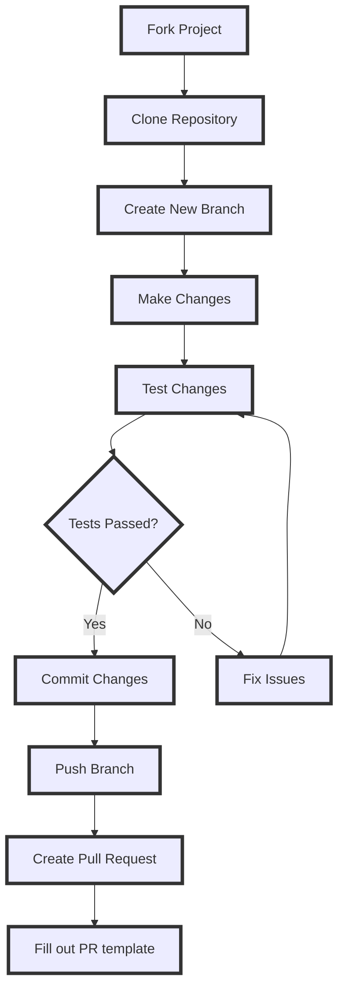

## 测试

* 运行预发布版本来测试 WinUtil 的最新改动，并把你遇到的问题反馈给我们，帮助 WinUtil 持续改进！

#### 运行最新的预发布版本

```ps1
irm https://christitus.com/windev | iex
```

:::caution
**请注意**，这是预发布版本，应按预发布版本对待。它的存在是为了让开发者在功能进入稳定版之前测试该工具，并报告或修复其中的问题。请勿在生产环境使用！
:::

## 问题反馈

* 如果你在使用脚本时遇到任何困难或问题，请通过 GitHub 仓库的「Issues」标签页提交。填写提供的模板，给出问题的具体细节，这样我（以及社区中的其他人）就能及时处理错误或考虑功能建议。

## 贡献代码

* 拉取请求现在直接提交到 **MAIN 分支**。这样做是因为我们现在可以通过 GitHub 的发布功能选择要发布的具体版本。

* 如果你要修改代码，可以向 `main` 分支提交 PR。

:::caution
不要使用代码格式化工具，不要改动大量代码行，也不要一次性提交多个功能改动。每一个功能改动都应该单独提交一个拉取请求！
:::

:::caution
在我们确定好语言支持的推进方式之前，暂时不要提交为 WinUtil 增加其他语言支持的拉取请求。
:::

* 创建拉取请求时，必须完整记录所做的全部更改。这包括但不限于：记录 `tweaks` 部分新增的内容以及对应的 `undo tweak`，以便用户在需要时能够移除新增的优化项；所有代码改动都需要有完整的文档说明。请在拉取请求描述中记录你的改动，并简要说明改动原因。不遵守此格式可能导致拉取请求被拒绝。此外，任何文档说明不充分的代码也可能被拒绝。

* 遵循这些准则，我们就能保持高质量标准，并确保代码库组织有序、文档完善。

:::note
创建函数时，请在文件名中包含「WPF」或「WinUtil」，以便它能被加载到运行空间中。
:::

## 操作指引

* 这是一份面向新手的指南。如果你仍然遇到问题，请查看以下 GitHub 官方文档：
    * [通过网页提交](https://docs.github.com/en/pull-requests/committing-changes-to-your-project/creating-and-editing-commits/about-commits)
    * [通过 GitHub Desktop 提交](https://docs.github.com/en/desktop/making-changes-in-a-branch/committing-and-reviewing-changes-to-your-project-in-github-desktop#about-commits)
    * [创建拉取请求](https://docs.github.com/en/pull-requests/collaborating-with-pull-requests/proposing-changes-to-your-work-with-pull-requests/creating-a-pull-request)


### 总览



:::note
这是一张指引你完成整个流程的示意图。根据你所做改动类型的不同，实际流程可能会有所差异。
:::

### 复刻仓库
* 在[此处](https://github.com/ChrisTitusTech/winutil)复刻 WinUtil 仓库，创建一个副本，它会出现在你的仓库列表中。


### 克隆复刻的仓库
:::tip
虽然你可以直接通过网页进行改动，但我们建议使用 GitHub Desktop 应用程序（WinUtil 中可安装）把仓库克隆到你的设备上，以便轻松测试你的复刻版本。
:::

* 如果尚未安装 GitHub Desktop，请先安装。
* 使用你复刻 WinUtil 时所用的同一个 GitHub 账号登录。
* 在「Your Repositories」下选择该复刻仓库，然后点击「clone `{repo name}`」
* 新建一个分支，并取一个与你的改动相关的名称。

* 现在你就可以用自己喜欢的文本编辑器随意修改 WinUtil 了。


### 测试你的改动

* 要测试改动是否达到预期效果，请在 PowerShell 终端中以管理员身份运行以下命令：

* 将运行命令的目录切换到复刻的项目。
* `cd {path to the folder with the compile.ps1}`
* 运行以下命令来编译并运行 WinUtil：
* `.\Compile.ps1 -run`


* 确认改动正常工作后，就可以把改动提交到仓库并发起 PR 了。相关帮助请参照下面的文档。

### 提交改动
* 提交改动之前，请丢弃对 `winutil.ps1` 文件所做的更改，如下所示：


* 现在，对结果满意后就提交你的改动。


* 推送改动，将其上传到你在 GitHub 上的复刻仓库。


### 发起 PR
* 要在你的仓库中以新分支向 main 分支发起 PR，会出现一个按钮，上面写着 Preview and Create pull request。点击该按钮并填写模板中要求的所有信息。信息全部填写正确后，检查一下你的 PR，确认其中没有附带 WinUtil.ps1 文件。一切就绪后发起 PR，等待 Chris（项目维护者）接受或拒绝你的 PR。一旦被 Chris 接受，你就能在「/windev」构建版本中看到自己的改动。
* 如果你在主构建版本「/win」中没看到自己的功能，这是正常的。所有新改动都会先进入 /windev 构建版本，确认一切正常后才会全面公开。
* 恭喜！你刚刚提交了自己的第一个 PR。非常感谢你为 WinUtil 做出贡献。
